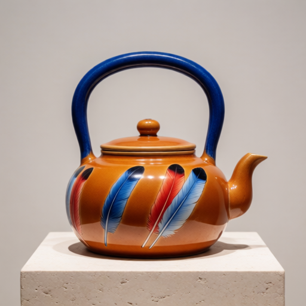
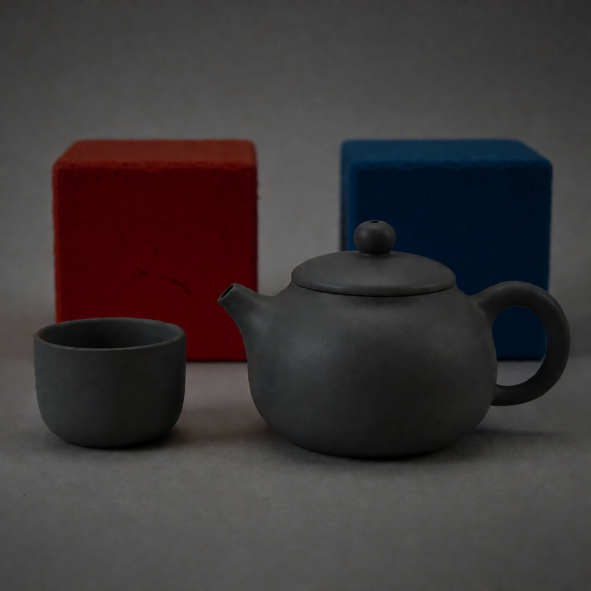
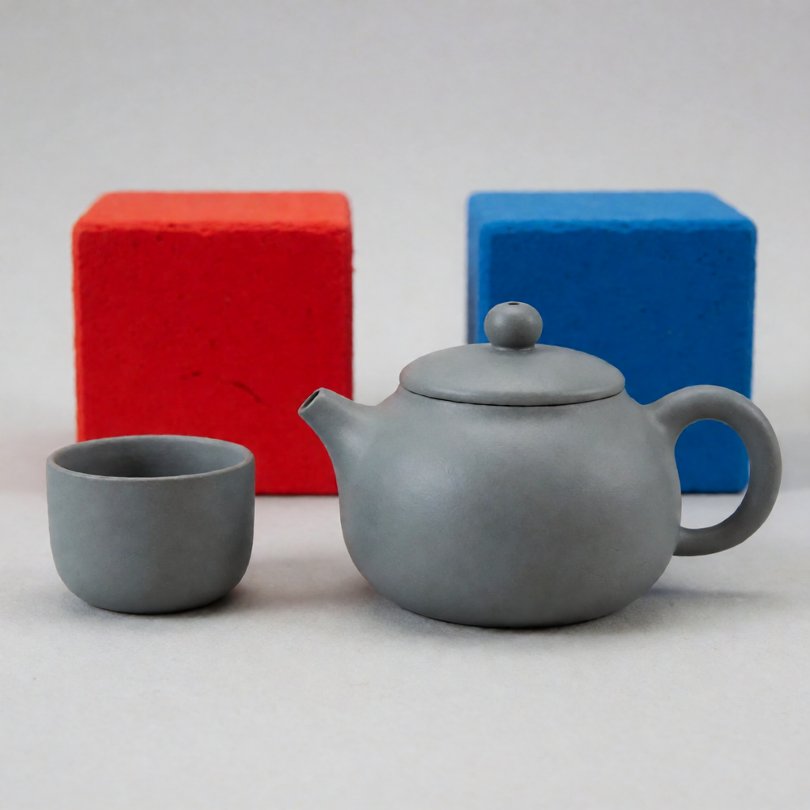
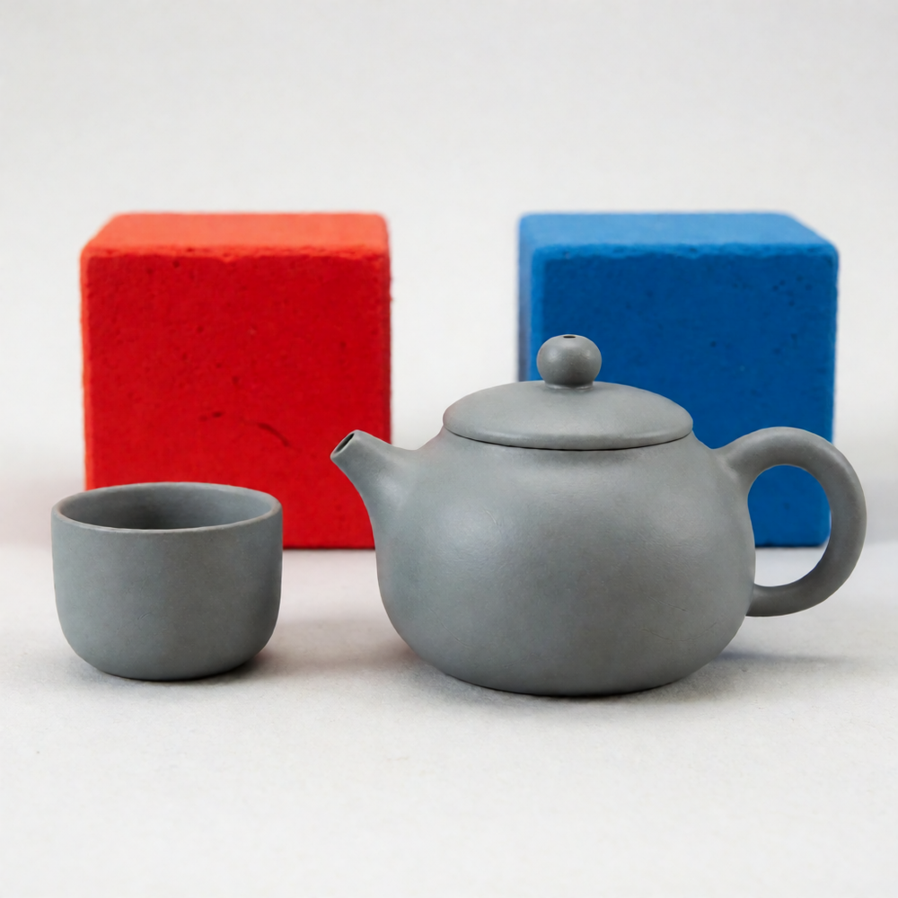

# ComfyUI Krea Reference

Guide Krea 2 with reference images and training-free concept sliders. **V11 is the current version to start with**, available in package 0.5.0 or newer. Existing V9/V10/Slider V1 workflows keep their original behavior.

| Choose a path | Start here |
|---|---|
| Reference cards or text-defined sliders in a portable ComfyUI workflow | [V11 user guide](docs/krea-v11-user-guide.md) |
| Experimental native image editing with the verified illumination example | [V13 setup and wiring](docs/krea-v13-native-carriers.md#setup-and-first-comparison) |
| Exact classes, ports and compatibility requirements | [Complete node index](docs/nodes/README.md) |

V12/V13 require current GitHub source and specific native host dependencies;
registry package 0.5.0 does not include them. V13's demonstrated illumination
effect is separate from V11's conditioning-based sliders.



V11 subject-plus-style guidance, using synthetic product and graphic references. See the [illustrated gallery](docs/krea-v11-gallery.md) for the inputs, settings and limitations.

## Verified native illumination example: V13

The opt-in [V13 native carrier studies](docs/krea-v13-native-carriers.md) now have
an actual signed illumination comparison. Keeping the selected instruction-token
states produces visible dimming and brightening while preserving this synthetic
scene's objects and arrangement. These are the actual rendered outputs, with
private PNG workflow metadata removed and the image pixels preserved exactly.

| Dim, native coefficient −1 | Neutral, 0 | Bright, native coefficient +1 |
|---|---|---|
|  |  |  |

Same source, preservation prompt and seed581102; Krea2 Turbo INT8 ConvRot with
General Edit V2 strength1, reference boost4, enhancerON/strength1, eight Euler
steps, simple schedule and CFG1. The effect is present before and after aspect
restoration. [Settings, literal poles and validation scope](docs/krea-v13-native-carriers.md#verified-signed-illumination-comparison)
document this one full-frame case. Other concepts, intermediate amounts and
combined axes are not generally calibrated. V13 is available from current GitHub
source; this update does not publish a new registry version.

## Start with V11

| What you want | Open |
|---|---|
| Guide an image with reference cards | [Native V11 Reference starter](example_workflows/krea-v11-reference-stack-workflow.json) |
| Adjust text-defined attributes | [Native V11 Concept Slider showcase](example_workflows/krea-slider-v11-showcase-workflow.json) |
| Install, connect nodes and understand controls | [V11 user guide](docs/krea-v11-user-guide.md) |
| Follow concrete prompts and recipes | [Nine worked examples](docs/krea-v11-worked-examples.md) |
| Inspect real V11 outputs | [V11 example gallery](docs/krea-v11-gallery.md) |

Download the raw workflow JSON and drag it into ComfyUI. Follow the [model/image setup instructions](example_workflows/README.md#open-directly-in-comfyui). These are native ComfyUI workflows; Photo Studio is not required. The reference example needs input images; the slider example does not.

The current slider showcase uses **automatic reach and budget**: card values determine the effective controls, up to the combined limit. This feature requires the latest GitHub source update after registry 0.5.0. See [automatic scaling](docs/krea-v11-user-guide.md#automatic-reach-and-budget) for migration and examples.

## Two V11 instruments

**Reference cards** assign jobs such as subject, visual style, lighting, layout or a counter-example to input images. Up to 12 cards feed the V11 reference stack. Sign-preserving balance limits signed layer targets; content/revision-aware caching speeds tuning. Recipes, including balanced, retain their established settings.

```text
Load Image → Image Guide Card V11 → Reference Stack Encoder V11 → sampler
```

**Concept Sliders** turn descriptions and paired endpoint text into attribute controls. Up to 8 cards feed the V11 slider stack. V11 adds automatic or manual combined budgeting, duplicate/opposite cancellation, per-card timing, height/crowd presets and a smoother transition near zero. No slider training or extra slider weights are needed.

```text
Concept Slider Card V11 → Concept Slider Stack V11 → sampler
```

| Plain prompt | V11 tiny adjustment | V11 working-range adjustment |
|---|---|---|
|  |  |  |

Same prompt and seed; brightness values 0, +0.05, +3. Tiny values stay closer to neutral, but stronger values can change shape and framing. Reference borders, fine-texture transfer and entangled attributes remain limitations. These are creative controls, not calibrated physical measurements. Supported V11 reference and slider workflows use separate encoders. The native V13 illumination comparison above has its own specific validation scope.

## Install

Install **Krea Reference** through ComfyUI Manager/Registry, or clone this repository into your ComfyUI custom_nodes folder:

```bash
cd /path/to/ComfyUI/custom_nodes
git clone https://github.com/kgilper/krea-reference.git
```

Restart ComfyUI and refresh the browser. Select installed Krea 2 diffusion, Krea Qwen3-VL encoder and Qwen image VAE files. This repo does not ship model weights. See the [V11 guide](docs/krea-v11-user-guide.md) for exact node class names and host requirements.

For an existing Git installation, run `git pull --ff-only` inside its package
folder, then restart ComfyUI and refresh the browser. Install only one copy of
the package. Native V12/V13 users should check the [additional host requirements](docs/krea-v13-native-carriers.md#requirements)
before updating: active native consumption checks exact dependency source
revisions and rejects unsupported combinations.

## Recipes, implementation and prior versions

- [Custom recipe kit](custom_recipes/README.md) and Recipe Builder in `web/recipe-builder.html`.
- [V11 technical notes](docs/krea-v11-technical-notes.md), [node index](docs/nodes/README.md) and [testing](docs/testing.md).
- [Experimental V12 native context and consumer API](docs/krea-v12-native-studies.md) for developers, used by the verified V13 illumination example. Source tests alone do not establish model support.
- V12 also offers an optional pinned Krea2T enhancer integration, default OFF, with exact MODEL bypass and owned temporary-hook cleanup. It was ON in the V13 example; its standalone quality benefit and broader task coverage remain unestablished.
- [Prior-version guides](docs/previous-versions/README.md): V10, V9 and Concept Slider V1, with their historical examples and technical papers.

Older nodes, assets and native workflows retain their original paths. Old guide URLs forward to their archive; no saved workflow is migrated automatically.

## Support and license

Krea Reference is free. Support development through [GitHub Sponsors](https://github.com/sponsors/kgilper?frequency=one-time), or contribute useful issues and examples. [MIT license](LICENSE).
